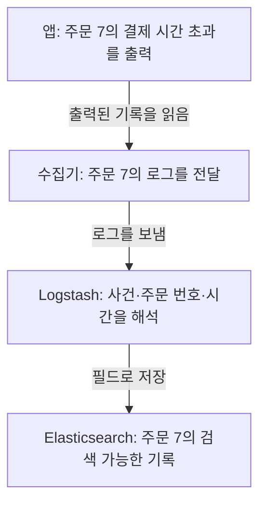
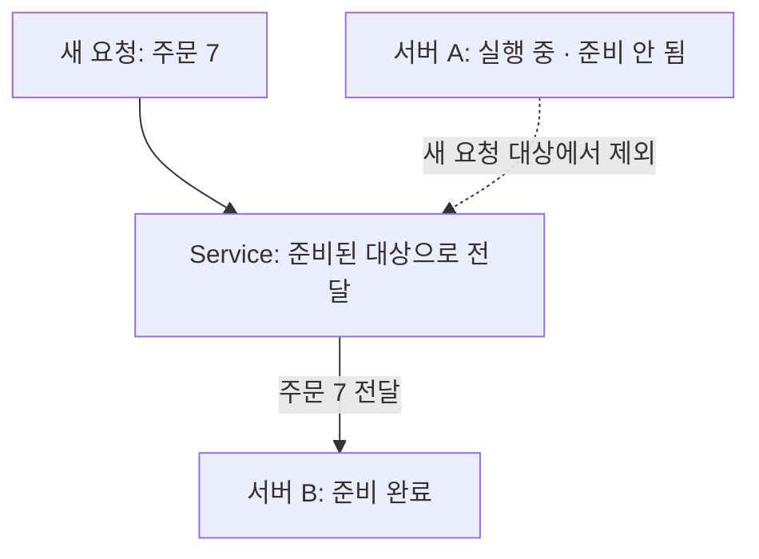

# 관측성 두 번째 묶음: 수집, 검색, 앱 상태 확인

상태: 2026-10-08 사용자 승인 후 공개 Study 3편과 로드맵에 적용했다.
조사일: 2026-10-08. 아래 세 편을 함께 게시하는 범위를 제안한다.

## 게시 범위

신규 파일은 모두 `content/study/cs/`에 둔다. 도구별 백과사전보다 관측성 학습 순서를 우선한다.
신규 글의 `date`는 실제 게시일, `status`는 `growing`, `draft`는 `false`,
`group`은 `observability-foundations`로 제안한다. 기존 글의 URL과 작성일은 바꾸지 않는다.

| 파일 / 슬러그 | 제목 | 핵심 질문과 한 줄 답 | 최소 조건 | 선수 → 다음 |
| --- | --- | --- | --- | --- |
| `log-collection-and-search.mdx` / `cs/log-collection-and-search` | 주문 오류 로그는 검색 화면까지 어떻게 갈까? | 로그 한 줄은 어떻게 검색 대상이 되나? → 수집기가 전달하고 처리기가 필드를 해석해 검색 저장소에 넣는다. 화면은 저장소에 조회한다. | 출력, 전달, 필드 해석, 저장이 각각 연결되어야 한다. 화면을 켜는 것만으로 수집되지 않는다. | `cs/structured-json-logs`, `cs/trace-span-event-identifiers` → 이번 Kibana 글 |
| `kibana-data-view-and-saved-objects.mdx` / `cs/kibana-data-view-and-saved-objects` | 주문 7의 오류 로그를 찾아서 다시 열어보기 | 무엇을 골라야 원하는 로그만 볼까? → 데이터 범위, 시간, 사건과 주문 조건을 고르고 검색 화면 설정을 저장한다. | Data View를 쓰는 Discover 흐름이며 로그가 먼저 저장되어 있어야 한다. 시간 필드는 날짜 타입, 예제 주문 번호는 숫자 타입이다. | 이번 수집 글 → 이번 Actuator 글 |
| `actuator-health-and-readiness.mdx` / `cs/actuator-health-and-readiness` | 서버가 켜졌다고 주문을 받아도 될까? | 실행 중인 앱과 요청을 받을 준비가 된 앱은 어떻게 구분하나? → Actuator의 준비 상태를 Kubernetes의 트래픽 판단에 연결한다. | Actuator 의존성, probe 기능과 Kubernetes probe 연결이 필요하다. readiness 성공이 모든 업무 성공을 보장하지 않는다. | `cs/logs-metrics-traces` → `cs/graceful-shutdown-and-traffic-draining` |

내부 초안의 '이번 글' 표기는 승인 후 실제로 생성된 파일끼리만 링크한다.
로드맵은 기존 추적 ID 뒤에 수집 → Kibana → Actuator를 넣고 기존 Graceful Shutdown으로 이어간다.
Prometheus, Grafana, Kafka Lag의 미작성 글은 아직 공개 링크로 만들지 않는다.

아래는 공개 본문 초안이다. 구현 코드보다 장면과 값이 바뀌는 모습을 먼저 보여준다.
주문 7, `payment_timeout`, 3000ms는 앞선 JSON 로그 글과 같은 학습용 예시다.

## 1편 본문: 주문 오류 로그는 검색 화면까지 어떻게 갈까?

### 01 · 서버에는 기록됐는데 검색 화면에는 없다

주문 7의 결제가 3초 동안 응답하지 않았다. 앱은 `payment_timeout` 로그를 남겼다.
그런데 운영자가 검색 화면에서 주문 7을 찾아도 나오지 않는다.

**앱이 로그를 출력하는 것과 검색 저장소에 저장되는 것은 다른 단계다.** 수집과 저장이 연결되어야 검색할 수 있다.

### 02 · 같은 기록이 이동하는 모습을 보자

아래는 학습용 수집 경로다. 각 칸에서도 같은 주문 7의 기록을 따라간다.



수집기는 로그를 읽어 옮기는 별도 프로그램이다. 여기서는 Fluent Bit 같은 수집기를 생각하면 된다.
Logstash는 입력을 받고 내용을 처리해 다른 곳으로 보내는 별도 프로그램이다. 설정 파일은 그 처리 순서를 정한다.
Elasticsearch는 기록을 저장하고 조건에 맞는 기록을 찾는 검색 엔진이다. 셋 다 Java 기본 클래스가 아니다.
[Logstash 처리 흐름](https://www.elastic.co/docs/reference/logstash/how-logstash-works)

### 03 · 화면은 저장된 기록을 물어본다

```text
운영자: “주문 7의 결제 시간 초과를 찾아줘”
  ↓ Kibana에서 검색 조건 입력
Elasticsearch에 조회 → 조건에 맞는 기록 반환 → Kibana가 표시
```

Kibana는 Elastic 데이터를 검색하고 보는 별도 웹 애플리케이션이다.
Elasticsearch가 화면으로 로그를 계속 밀어 넣는다는 뜻이 아니다. 수집 경로와 조회 경로를 구분한다.
[Kibana Discover](https://www.elastic.co/docs/explore-analyze/discover/discover-get-started)

### 04 · 안 보인다면 마지막으로 확인된 지점을 찾는다

앱 출력에 주문 7이 있는지, 수집기가 읽고 보냈는지, 처리기가 거절하지 않았는지,
저장소에 기록이 있는지 차례로 확인한다. 저장소에 있다면 화면의 데이터 범위와 시간 조건을 확인한다.
검색 결과가 없다는 것만으로 앱 오류나 로그 유실을 단정하지 않는다.

<details>
<summary>Kafka, Filebeat, OpenSearch도 꼭 필요한가?</summary>

아니다. 수집 경로는 환경에 따라 다르다. 이번 경로는 Kafka를 거치지 않는 예시다.
Kafka를 중간에 넣어도 보관, 전달과 재처리 정책 없이 로그 유실 방지가 자동 완성되지는 않는다.
Filebeat도 수집에 사용할 수 있지만 이번 로컬 프로젝트 설정에서 확인한 수집기는 Fluent Bit다.

OpenSearch는 별도의 검색 엔진이고 해당 화면 제품은 OpenSearch Dashboards다.
여기의 Elasticsearch/Kibana 설정을 이름만 바꿔 그대로 사용할 수 있다고 가정하지 않는다.
[OpenSearch Dashboards](https://docs.opensearch.org/latest/dashboards/)

</details>

### 프로젝트에서는 어디를 확인했나?

2026-10-08 로컬 PromptHub의 Fluent Bit 전송 설정, Logstash의 JSON 해석과 분기 설정,
Elasticsearch 출력 설정을 대조했다. 애플리케이션 로그와 결제 감사 로그의 경로도 구분되어 있다.
**설정이 있다는 근거이며, 주문 7이 실제 운영 화면에 도착했거나 유실이 없다는 검증은 아니다.**

기존 검색 이벤트 수집 글은 행동 이벤트와 상세 설정을 공부할 때 연결한다. 이번 글은 오류 로그 한 줄의 이동만 설명한다.

### 자기 말로 답해보기

저장소에는 주문 7의 기록이 있다. Kibana에서 안 보이면 수집기를 바로 고쳐야 할까?

<details>
<summary>답 확인</summary>

아니다. 먼저 선택한 데이터 범위, 시간과 검색 조건을 확인한다. 저장소까지 도착한 사실이 있으므로 조회 조건부터 좁힌다.

</details>

## 2편 본문: 주문 7의 오류 로그를 찾아서 다시 열어보기

### 01 · 많은 기록 중 주문 7만 찾고 싶다

여러 앱의 기록이 쌓여 있다. 주문 7의 결제가 시간 초과된 시각은 10월 8일 오전 10시 5분이다.
다음은 시간 필드를 추가한 학습용 기록이다. 실제 고객의 주문이나 운영 로그가 아니다.

```json
{"@timestamp":"2026-10-08T10:05:00+09:00","event":"payment_timeout","orderId":7,"durationMs":3000}
```

**어느 데이터에서, 언제의 기록을, 어떤 조건으로 찾는지** 세 가지를 고른다.

### 02 · 검색 범위와 시간을 먼저 고른다

Data View는 Kibana에서 검색할 데이터 범위와 필드를 보는 설정이다. 여기서는 `app-logs-*`라는
학습용 범위로 `app-logs-2026.10.08` 등의 이름을 가진 저장 데이터를 고른다. `*`는 뒤가 달라도 포함한다는 뜻이다.
기록을 복사해 새로 저장하는 기능은 아니다.
[Data View 만들기](https://www.elastic.co/docs/explore-analyze/find-and-organize/data-views/create-data-view)

아래는 **실제 Kibana 화면 캡처가 아닌 이해용 화면 스케치**다. Data View를 사용하는 Discover 흐름을 보여준다.

```text
┌ 주문 오류 찾아보기 ────────────────────────┐
│ 데이터: app-logs-*                        │
│ 시간: 10/8 10:00 ~ 10:10 (한국 시간)        │
│ 조건: 결제 시간 초과 + 주문 번호 7          │
├──────────────────────────────────────────┤
│ 10:05  주문 7  payment_timeout  3000ms     │
└──────────────────────────────────────────┘
```

시간 기준은 `@timestamp`다. 이 필드가 날짜 타입으로 저장되어 있고 화면의 시간대가 한국 시간이라는 조건이다.
지금 시각 기준 '최근 15분'을 고르면 과거 10시 5분 기록은 안 보일 수 있다.

### 03 · 사건과 주문 번호를 조건으로 넣는다

<details>
<summary>검색창에 실제로 쓰는 조건은?</summary>

KQL은 Kibana 검색창에서 조건을 적는 문법이다. Java 코드나 별도 설치 라이브러리가 아니다.
예제에서는 `event`가 사건 이름을 찾을 수 있는 필드, `orderId`가 숫자 필드라는 전제다.

```text
event: "payment_timeout" and orderId: 7
```

입력하면 선택한 데이터와 시간 범위 안에서 두 조건을 함께 만족하는 기록을 찾는다.
프로젝트에서 필드를 다른 이름이나 구조로 저장했다면 조건도 바꿔야 한다.
Kibana의 ES|QL 방식은 Data View 없이 조회할 수도 있다. 이 글은 모든 검색 방식을 설명하지 않는다.
[Discover 사용하기](https://www.elastic.co/docs/explore-analyze/discover/discover-get-started)

</details>

### 04 · 저장하는 것은 기록이 아니라 보는 방법이다

```text
오늘: 데이터 범위 + 검색 조건 + 표시할 열을 정함 → 검색 화면 저장
다음: 저장한 검색 화면을 엶 → 그때의 시간 조건으로 데이터를 다시 조회
```

Saved Object는 Data View, 검색 화면, 대시보드처럼 다시 사용할 설정을 저장한 객체다.
Data View도 Saved Object의 한 종류다. 시간 범위를 함께 저장했는지에 따라 다음에 조회할 범위가 달라질 수 있다.
**설정을 내보낸 파일은 원본 로그 데이터의 백업이 아니다.**
[Saved Objects](https://www.elastic.co/docs/explore-analyze/find-and-organize/saved-objects)

### 프로젝트에서는 어디를 확인했나?

2026-10-08 로컬 PromptHub에서 Gateway 로그 범위와 `@timestamp`를 지정한 Data View 파일,
그 파일을 Kibana에 가져오도록 작성된 설정을 확인했다. 가져오기 성공이나 실제 검색 결과까지 확인한 것은 아니다.
프로젝트의 실제 범위 이름과 이 글의 `app-logs-*` 예시도 구분한다.

### 자기 말로 답해보기

Saved Object 파일만 다른 환경으로 옮겼다. 주문 7의 원본 로그도 함께 옮겨졌을까?

<details>
<summary>답 확인</summary>

아니다. 설정을 옮긴 것이다. 새 환경에도 원본 데이터와 필요한 접근 권한이 있어야 조회할 수 있다.

</details>

## 3편 본문: 서버가 켜졌다고 주문을 받아도 될까?

### 01 · 새 서버가 아직 준비 중이다

주문 서버 A는 실행을 시작했지만 아직 요청을 받을 준비가 안 됐다. 서버 B는 준비가 끝났다.
이때 주문 7을 A로 보내고 싶지는 않다.

**살아 있는지와 새 요청을 받아도 되는지는 다른 질문이다.** Spring Boot Actuator는 앱의 상태를 확인하는
외부 라이브러리 기능이다. Java 기본 기능이 아니며 앱에 관련 의존성이 있어야 한다.

### 02 · 주문 7이 준비된 서버로 가는 모습

아래는 Kubernetes Service를 통해 새 요청을 보내는 개념 장면이다. 앱이 준비 상태를 정확히 알리고
readiness probe가 이를 확인하며 대상 변경이 반영되었다는 조건이다.



readiness는 “새 요청을 받아도 되는가?”를 확인한다. 실패한 서버를 Service의 준비된 대상에서 제외하는 데 쓴다.
readiness 실패 자체는 재시작 명령이 아니며 기존 연결이 즉시 끊긴다는 뜻도 아니다.
[Kubernetes probes](https://kubernetes.io/docs/tasks/configure-pod-container/configure-liveness-readiness-startup-probes/)

### 03 · 상태 확인과 조치는 누가 할까?

Actuator는 상태 확인 경로에서 응답한다. Kubernetes의 probe는 그 경로를 주기적으로 확인한다.
probe는 상태를 확인하는 검사라는 뜻이다. 두 가지 역할을 혼동하지 않는다.

```text
/actuator/health/readiness → 지금 새 요청을 받을 준비가 됐나?
/actuator/health/liveness  → 앱이 스스로 살아 있는 상태인가?
```

liveness 검사 실패가 설정된 기준에 도달하면 Kubernetes는 해당 컨테이너를 재시작한다.
주문 한 건이 실패했다고 곧바로 재시작되는 구조는 아니다.
[Kubernetes probes](https://kubernetes.io/docs/tasks/configure-pod-container/configure-liveness-readiness-startup-probes/)

### 04 · UP이 결제 성공 보증은 아니다

상태 확인에서 `UP`을 받아도 다음 주문의 결제가 성공한다는 보증은 아니다.
무엇을 검사하는 상태인지 확인해야 한다. 기본 readiness/liveness 그룹이 외부 결제 API까지 자동 검사하지는 않는다.
외부 API 장애를 liveness에 그대로 넣으면 여러 서버를 함께 재시작해 장애를 키울 수 있다.
[Spring Boot의 Kubernetes probes](https://docs.spring.io/spring-boot/reference/actuator/endpoints.html#actuator.endpoints.kubernetes-probes)

<details>
<summary>앱에서는 어떤 의존성과 설정을 확인할까?</summary>

Spring Boot 앱에는 `org.springframework.boot:spring-boot-starter-actuator` 의존성을 사용한다.
아래는 probe 기능을 명시적으로 켜는 앱 설정 예시다. Kubernetes의 probe 등록과는 별개다.

```yaml
management:
  endpoint:
    health:
      probes:
        enabled: true
```

웹 경로는 기본 Actuator 경로를 전제한다. 프로젝트가 포트, 경로, 노출과 보안을 바꾸었다면 함께 확인한다.
상태 확인을 위해 모든 관리 기능을 공개할 필요는 없다. 시작 시간을 기다리는 startup probe와
종료 중 요청 보호는 후속 학습으로 연결한다.
[Actuator endpoints](https://docs.spring.io/spring-boot/reference/actuator/endpoints.html)

</details>

### 프로젝트에서는 어디를 확인했나?

2026-10-08 로컬 PromptHub의 공통 앱 의존성에 Actuator가 있고, 주문 서비스 배포 설정에
readiness/liveness 경로를 구분한 probe가 있음을 확인했다. 이것은 **설정 확인**이다.
실제 상태 응답, 트래픽 제외와 재시작 결과를 관측한 것은 아니다.

### 자기 말로 답해보기

결제 API가 느리다. 모든 주문 서버의 liveness를 실패시키면 언제나 도움이 될까?

<details>
<summary>답 확인</summary>

아니다. 외부 API의 지연은 주문 서버를 재시작해도 해결되지 않을 수 있다.
서버 자체의 상태와 외부 의존성 실패를 구분하고, Timeout 같은 호출 보호를 따로 검토한다.

</details>

## 조사 근거와 범위 — 공개 본문과 분리한 내부 기록

로컬 근거 저장소: `C:/programmers_prj/beadv6_6_3JMT_BE`.
로컬 파일 확인은 원격 HEAD, 배포 버전, 운영 성능과 실제 성공 결과 확인이 아니다.
아래 경로는 내부 확인 기록이다. 공개 본문에 내부 호스트, 비밀 참조 이름이나 설정 원문을 복사하지 않는다.

| 근거 파일 | 확인한 것 | 확인하지 않은 것 |
| --- | --- | --- |
| `build.gradle` | Java 21, Spring Boot 4.1.0, 공통 앱 Actuator 의존성 | 모든 개별 서비스의 런타임과 실제 배포 버전 |
| `k8s/addons/elk/fluent-bit.yaml` | 컨테이너 로그 읽기와 Logstash HTTP 전송 설정 | 수집 성공, 누락률 |
| `k8s/addons/elk/logstash.yaml` | JSON 해석, 허용 로그 분기, Elasticsearch 출력; 감사 로그는 별도 경로 | 모든 애플리케이션 로그가 저장되거나 Kafka를 통과한다는 주장 |
| `k8s/addons/elk/dashboards/gateway-data-view.ndjson` | Gateway 데이터 범위와 시간 필드; 파일의 내부 타입 표기는 `index-pattern` | 실제 Data View 존재와 조회 성공 |
| `k8s/addons/elk/kibana-operations-dashboards.yaml` | Data View 파일을 가져오는 설정 | 실제 import 성공, 모든 대시보드가 같은 NDJSON 방식이라는 주장 |
| `config/src/main/resources/configs/application.yml` | 관리 웹 endpoint 노출 설정 | 인증과 접근 제어 전체, 모든 endpoint의 외부 공개 |
| `k8s/base/services/order/deployment.yaml` | probe 기능 활성화, startup/readiness/liveness 경로 | 실제 응답과 대상 제외, 재시작 결과 |
| `k8s/addons/elk/elasticsearch.yaml`, `k8s/addons/elk/kibana.yaml` | 로컬 이미지 설정 9.4.3 | 실제 운영 이미지 버전 |

2026-10-08 조사 시 공식 릴리스 노트 상단의 Elasticsearch/Kibana 버전은 9.5.5,
Spring Boot 공식 문서의 최신 안정 버전은 4.1.1이다. 프로젝트 설정의 9.4.3/4.1.0과 구분한다.
이번에는 업그레이드하지 않으며 최신 UI 메뉴 이름이 프로젝트 화면과 같다고 가정하지 않는다.
게시 시점이 달라지면 날짜와 버전 주장을 재확인한다.

- [Elasticsearch release notes](https://www.elastic.co/docs/release-notes/elasticsearch)
- [Kibana release notes](https://www.elastic.co/docs/release-notes/kibana)
- [Spring Boot stable documentation](https://docs.spring.io/spring-boot/index.html)

중복 검토: `es/search-event-log-pipeline`은 행동 이벤트와 파이프라인 상세 글로 유지한다.
`cs/graceful-shutdown-and-traffic-draining`은 종료 중 트래픽 제외와 요청 마무리에 집중한다.
이번에는 두 기존 글을 수정하지 않는다. 새 Actuator 글은 상태 확인 기능의 출처와 두 역할에 집중한다.
기존 수집 글의 유실 보장처럼 범위가 큰 표현과 Graceful Shutdown 글의 영상 측정값은 별도 근거 보완 후보로 남긴다.

시각화 선택: 수집은 한 기록의 이동, Kibana는 화면 스케치와 저장 전후,
Actuator는 준비 안 된 A와 준비된 B의 요청 배분으로 보여준다. 새 이미지나 UI 컴포넌트는 필요하지 않다.

## 승인과 검증 범위

승인을 받으면 위 신규 MDX 3개를 작성하고 로드맵 데이터/정책 테스트 두 파일에만 연결한다.
관련 승인 계획은 승인 후 `docs/code-plans/`에 저장한다. 공통 스킬, 백엔드와 기존 공개 글은 수정하지 않는다.

게시 전에는 승인 파일의 민감정보를 자동 점검하고 애매한 정보만 질문한다.
선수/관련 링크와 슬러그, frontmatter, 토글/코드 블록, Mermaid 구문을 점검하고
로드맵 정책 테스트 실패 → 순서 연결 → 전체 테스트/타입 검사/콘텐츠 빌드를 확인한다.
아직 localhost 브라우저는 차단되어 화면 검수와 실제 Mermaid 렌더링은 미완료다.
접근 차단을 우회하거나 문서 생성 성공을 화면 검수 완료로 보고하지 않는다.

## 적용 결과 — 2026-10-08

- 승인된 신규3편과 로드맵 순서/정책 테스트 두 파일에 적용했다. 기존 공개 글과 스킬,
  프로젝트 Learning Path와 백엔드는 변경하지 않았다.
- 승인 계획: `docs/code-plans/2026-10-08-observability-collection-discover-health.md`.
- 변경 전 새 순서 테스트 1개 실패 → 연결 후 전체86개 통과. TypeScript 검사 통과.
- 4000번 기존 개발 서버와 분리한 임시 복사본에서 `npm run build` 통과.
  전체 사이트206개 재생성 중 이번 신규 Study는 3개다. 206개 글을 새로 작성한 것이 아니다.
- 생성된3편의 제목/질문/요약/날짜/공개 상태, 선수·관련 링크와 토글/회상 질문 확인.
- 공개 초안/MDX와 승인 diff의 민감정보 자동 점검 통과. 내부 경로와 설정 원문은 공개하지 않았다.
  실제 프로젝트 설정을 직접 인용하는 예제 코드도 없다. 본문의 JSON과 YAML은 학습용이다.
- Mermaid는 정적 구문을 검토했지만 실제 브라우저 렌더링과 화면 검수는 미완료다.
  접근 차단을 우회하지 않았다. 실제 운영 수집, Data View import와 probe 동작도 시험하지 않았다.
- 승인된 신규3편, 로드맵2파일과 승인 계획은 `8c828a1`로 커밋했다. push하지 않았다.
  검증용 임시 복사본만 삭제했으며 원본 의존성과 기존4000번 서버는 보존했다.
  로컬 개발용 생성 데이터에도 새3편이 포함됨을 확인했다. 이 확인은 화면 검수를 대신하지 않는다.
