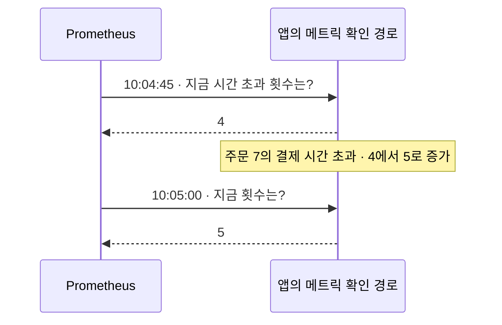
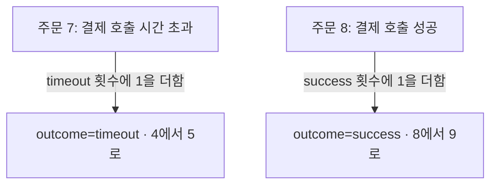

# 관측성 세 번째 묶음: 숫자 수집과 Label 설계

상태: 2026-10-08 사용자 승인 후 공개 Study2편과 로드맵에 적용했다.
조사일: 2026-10-08. 이번에는 신규2편을 함께 제안한다.

## 게시 범위

두 글 모두 category는 `cs`, group은 `observability-foundations`, status는 `growing`이다.
게시 승인 후 신규 글의 date는 실제 게시일, draft는 false로 작성한다.
기존 글의 URL/날짜/결론과 프로젝트 Learning Path는 바꾸지 않는다.

| 파일 / 슬러그 | 제목 | 핵심 질문 / 한 줄 답 | 최소 조건 | 선수 → 다음 | 프로젝트 근거 |
| --- | --- | --- | --- | --- | --- |
| `content/study/cs/prometheus-metric-scraping.mdx` / `cs/prometheus-metric-scraping` | 결제 오류 횟수는 누가 세고, 누가 가져갈까? | 결제 시간 초과를 시간별 숫자로 보려면? / 앱이 횟수를 세고, Prometheus가 주기적으로 읽어 시각과 함께 저장한다. | 측정 코드, Prometheus 형식의 endpoint, 접근 가능한 수집 대상 설정이 연결되어야 한다. 횟수는 호출 기준이며 누적값과 구간 증가량을 구분한다. | `cs/logs-metrics-traces`, `cs/actuator-health-and-readiness` → 이번 Label 글 | 주문 예약/만료의 Micrometer 구현과 호출부, 테스트 소스; 수집 연결은 미확인 |
| `content/study/cs/metric-label-cardinality.mdx` / `cs/metric-label-cardinality` | 메트릭에 주문 번호를 붙이면 왜 부담이 커질까? | 어떤 이름표로 숫자를 나눠 세야 할까? / 집계 목적에 필요한 제한된 분류로 나누고, 주문 번호 같은 계속 늘어나는 값은 일반 Label로 넣지 않는다. | 이름과 전체 Label 조합마다 별도 시계열이다. 값의 종류와 실제 조합 수를 함께 본다. 개인 정보의 무조건 로그 기록도 권하지 않는다. | 이번 Prometheus 글 → Grafana/알림은 내부 후속 백로그 | 예약/만료 결과의 enum 분류와 식별자 tag를 제외하는 테스트 소스 |

공개 로드맵은 기존 Actuator → Graceful Shutdown 연결을 유지한 뒤 수집 → Label을 넣는다.
미작성 Grafana/알림 글은 공개 링크로 만들지 않는다. 관련 읽기에는 기존 DB 병목 진단 글을 연결한다.

## 1편 본문: 결제 오류 횟수는 누가 세고, 누가 가져갈까?

### 01 · 주문 7 말고도 결제가 실패했을까?

주문 7의 결제가 3초 뒤 시간 초과됐다. 로그로 그 사건은 찾았다.
이번에는 “시간 초과된 결제 호출이 최근 얼마나 있었지?”를 숫자로 보고 싶다.

앱에서 횟수를 세고, **Prometheus가 주기적으로 읽어 시각과 함께 저장**한다.
Prometheus는 숫자의 변화를 수집하고 저장하는 별도 서버 프로그램이다. Java 기본 기능이 아니다.
아래 값은 실제 장애 측정이 아닌 학습용이다.
[Prometheus 개요](https://prometheus.io/docs/introduction/overview/)

### 02 · 주문 7의 사건이 숫자 하나를 바꾼다

```text
앱의 시간 초과 횟수: 4
       ↓ 주문 7의 결제 호출이 시간 초과되어 1을 더함
앱의 시간 초과 횟수: 5
```

이런 누적 횟수를 세는 측정값이 **Counter**다. 같은 앱에서 늘어나다가 재시작 등으로 초기화될 수 있다.
호출 한 번마다 1을 더하는 예시이므로 재시도가 있으면 주문 수와 꼭 같지는 않다.
[Counter의 의미](https://prometheus.io/docs/concepts/metric_types/)

### 03 · Prometheus가 숫자를 가지러 온다



수집기가 값을 요청하고 앱이 응답한다. 이렇게 주기적으로 숫자를 읽는 것을 **scrape(수집)**라고 한다.
앱이 결제 오류를 발견할 때마다 Prometheus로 오류 문장을 보내는 구조가 아니다.
[Prometheus 수집 방식](https://prometheus.io/docs/introduction/overview/)

### 04 · 횟수에 시각이 붙으면 변화를 볼 수 있다

```text
10:04:45  4  →  10:05:00  5  →  10:05:15  7
               +1              +2
```

같은 앱에서 재시작과 측정 누락이 없다는 조건이면 이 사이 새 시간 초과 호출은 3번이다.
시각에 따라 쌓은 숫자 기록을 **시계열**이라고 한다. `7`만 보고 '최근 30초에 7번 실패'라고 읽으면 안 된다.
[Prometheus 데이터 모델](https://prometheus.io/docs/concepts/data_model/)

이 숫자에는 주문 7의 오류 문장이나 실패 원인이 없다. 개별 사건은 로그로 다시 확인한다.

<details>
<summary>Java 앱에서 숫자는 어떻게 세고, 어디에서 보여줄까?</summary>

Micrometer는 앱의 숫자 측정에 사용하는 외부 Java 라이브러리다.
`MeterRegistry`는 측정값을 등록하고 조회하는 객체이며, Spring Boot 앱은 관련 설정에 따라 이를 제공한다.
아래 `registry`는 그 객체다. 결제 호출의 시간 초과를 기록하는 지점에서 실행하는 부분 예시이지 독립 실행 프로그램은 아니다.

```java
Counter timeouts = registry.counter("payment.calls", "outcome", "timeout");
timeouts.increment();
```

`Counter`와 `MeterRegistry`는 `io.micrometer.core.instrument`에서 제공한다.
첫 줄은 이름이 `payment.calls`, 결과 이름표가 `outcome=timeout`인 Counter를 등록하거나 기존 것을 가져온다.
둘째 줄은 그 Counter에 1을 더한다. 위의 기존 값이 4라면 5가 된다. 주문 번호는 이 Counter에 저장하지 않는다.
[Micrometer Counters](https://docs.micrometer.io/micrometer/reference/concepts/counters.html)

Spring Boot에서 Prometheus 형식으로 제공하려면 Actuator 외에
`io.micrometer:micrometer-registry-prometheus` 의존성과 endpoint 노출 설정도 확인한다.
이 라이브러리가 이름을 Prometheus 형식으로 바꾸면 예제 출력은 다음 모양이다.

```text
payment_calls_total{outcome="timeout"} 5
```

`outcome`은 결과를 나눠 세는 이름표이며 다음 글에서 Label 설계를 설명한다.
`/actuator/prometheus`를 Prometheus가 읽을 수 있도록 수집 대상의 주소/경로/권한을 연결해야 한다.
Actuator가 설치되어 있다고 수집까지 자동 완료되는 것은 아니다. 메트릭 경로를 인터넷에 무조건 공개하지 않는다.
[Micrometer Prometheus 연동](https://docs.micrometer.io/micrometer/reference/implementations/prometheus.html),
[Spring Boot Metrics](https://docs.spring.io/spring-boot/reference/actuator/metrics.html)

기존 Timer로 같은 사건의 시간과 횟수를 이미 측정한다면 횟수를 세기 위한 별도 Counter가 꼭 필요한지 먼저 확인한다.
Timer도 측정한 사건의 횟수를 제공한다. 위 예제는 원리를 보여주는 별도 Counter다.
[Micrometer Counters](https://docs.micrometer.io/micrometer/reference/concepts/counters.html)

</details>

<details>
<summary>재시작했거나 최근 5분만 보고 싶다면?</summary>

단순히 마지막 값에서 처음 값을 빼면 재시작으로 줄어든 Counter를 잘못 해석할 수 있다.
PromQL은 Prometheus에서 숫자를 조회하는 문법이다. 수집한 예제 지표의 최근5분 증가량은 다음처럼 조회한다.

```text
increase(payment_calls_total{outcome="timeout"}[5m])
```

재시작으로 값이 초기화된 상황을 보정하고 시간 범위로 환산하므로 소수 결과가 나올 수도 있다.
모든 사건의 정확한 원장을 복구하는 기능은 아니다. 여러 서버의 값은 서버별 증가량을 구한 뒤 집계한다.
`rate`는 구간의 증가 속도를 초당 평균으로 볼 때 사용한다.
[Prometheus increase/rate](https://prometheus.io/docs/prometheus/latest/querying/functions/)

</details>

### 프로젝트에서는 어디를 확인했나?

2026-10-08 로컬 PromptHub 주문 서비스의 Micrometer 구현에서 주문 예약 시도와 만료 처리 횟수를 세는 코드,
이를 호출하는 서비스/워커와 테스트 소스를 확인했다. 위 결제 Counter가 실제 구현되어 있다는 뜻은 아니다.

확인한 Gradle과 YAML/Java/TOML 파일 검색에서는 Prometheus registry 의존성이나 수집 대상 설정을 찾지 못했다.
외부 운영 환경에도 없다는 결론은 아니다. **앱의 측정 코드와 Prometheus 운영 수집 완료는 구분한다.**
원격 HEAD/배포 상태, 실제 endpoint 응답과 수집 결과는 확인하지 않았다.

### 자기 말로 답해보기

앱에서 Counter가 4에서 5로 늘었다. Prometheus에도 반드시 저장됐을까?

<details>
<summary>답 확인</summary>

아니다. 앱의 측정값이 바뀐 것이다. 해당 값이 확인 경로에 나오고 Prometheus가 정상적으로 수집했는지 별도로 확인한다.

</details>

## 2편 본문: 메트릭에 주문 번호를 붙이면 왜 부담이 커질까?

### 01 · 결제 성공과 시간 초과를 나눠 보고 싶다

주문 7의 결제 호출이 시간 초과됐다. 성공한 호출과 구분해서 숫자를 보고 싶다.
이때 메트릭에 **Label(분류 이름표)**을 붙인다. 이번 예시의 이름표는 `outcome`, 값은 `success` 또는 `timeout`이다.
실제 운영 수치가 아니라 한 앱의 학습용 장면이다.

### 02 · 같은 이름표면 같은 숫자에 더한다



하나의 지표 이름 `payment_calls_total`을 결과별로 나눠 센다. 주문 번호가 달라도 결과 이름표가 같으면
같은 시계열에 더한다. 실제로는 서버 등 다른 Label까지 모두 같아야 같은 시계열이다.
[Prometheus 데이터 모델](https://prometheus.io/docs/concepts/data_model/)

### 03 · 주문마다 새 이름표를 만들면 칸이 계속 늘어난다

```text
결과만 나눔
  success: 9    timeout: 5

주문 번호까지 나눔
  orderId=7, timeout: 주문 7 전용 횟수
  orderId=8, success: 주문 8 전용 횟수
  orderId=9, timeout: 주문 9 전용 횟수
  새 주문마다 새로운 조합이 추가됨
```

Prometheus는 **지표 이름과 전체 Label 조합마다 별도 시계열**을 만든다.
값의 종류와 조합이 많아지는 것을 높은 **카디널리티(cardinality)**라고 부른다.
주문 번호, 사용자 번호, 검색어처럼 계속 새 값이 들어오면 저장과 메모리, 조회 부담이 커질 수 있다.
[Prometheus Label 설계](https://prometheus.io/docs/practices/naming/)

### 04 · 전체 숫자와 개별 사건을 다른 곳에 둔다

```text
메트릭: “시간 초과 호출이 얼마나 생겼나?” → outcome=timeout
로그:   “주문 7에서 무슨 일이 있었나?”  → 필요한 식별자로 사건 찾기
```

Label은 집계 목적에 필요한 제한된 분류로 고른다. 개별 주문을 추적하려고 주문 번호를 일반 Label에 넣지 않는다.
로그에도 개인정보를 무조건 넣는다는 뜻은 아니다. 필요한 식별자, 접근 권한과 보관 정책을 정한다.

<details>
<summary>이름표는 적기만 하면 괜찮을까?</summary>

이름표 하나라도 값이 끝없이 늘어나면 부담이 커진다. 반대로 여러 이름표도 값과 조합이 제한되어 있으면 목적에 맞게 쓸 수 있다.
예를 들어 결과2종류 × 결제수단2종류 × 서버3대는 모든 조합이 나타난다는 조건에서 최대12개 시계열이다.
관측하지 않은 조합까지 자동으로 생긴다는 뜻은 아니며, 다른 Label/지표와 서버 교체에 따른 누적 변화도 함께 본다.

이것은 개수만 보여주는 예시다. 12개까지는 안전하고 그 이상은 위험하다는 고정 기준이 아니다.
같은 지표에는 Label의 이름 구성을 일관되게 쓴다. Micrometer에서 이 분류는 tag라고 부르며
Prometheus 출력에서는 Label이 된다.
[Micrometer의 tag 구성](https://docs.micrometer.io/micrometer/reference/implementations/prometheus.html)

추적 ID를 메트릭과 연결하는 exemplar라는 별도 기능도 있다. 일반 Label에 모든 traceId를 넣는 것과는 다르다.
이 글에서는 해당 기능의 설정과 구현까지 다루지 않는다.
[Micrometer Exemplars](https://docs.micrometer.io/micrometer/reference/implementations/prometheus.html)

</details>

### 프로젝트에서는 어디를 확인했나?

2026-10-08 로컬 PromptHub의 주문 예약/만료 메트릭 구현은 결과와 처리 출처를 enum의 제한된 값으로 나눈다.
관련 테스트 소스에는 Counter 값 확인과 `orderId`, `eventId` 등의 식별자 tag를 제외하는 검사가 있다.

이번에는 **구현과 테스트 소스를 읽은 것**이다. 테스트 실행, 실제 수집 시계열 수와 운영 비용 감소를 검증한 것은 아니다.
그 프로젝트의 지표가 위 결제 지표와 같은 이름이라는 뜻도 아니다.

### 자기 말로 답해보기

Label이 `orderId` 하나뿐이다. 이름표가 한 개니까 값이 수백만 개여도 부담이 작을까?

<details>
<summary>답 확인</summary>

아니다. 이름표 개수보다 서로 다른 값과 실제 조합이 중요하다. 새 주문 번호마다 별도 시계열이 생길 수 있다.

</details>

## 내부 조사 기록 — 공개 본문과 분리

근거 저장소는 `C:/programmers_prj/beadv6_6_3JMT_BE`다. 원격 HEAD와 배포 환경은 조회하지 않았다.
현재 로컬 파일을 읽고 아래 범위의 주장을 대조했다. 외부 백엔드는 수정하거나 실행하지 않았다.

| 로컬 근거 | 확인한 범위 |
| --- | --- |
| `build.gradle`, `order-service/build.gradle` | Spring Boot4.1.0/Java21, 공통 Actuator, 주문 서비스 의존성 |
| `order-service/.../infra/metrics/MicrometerOrderExpirationMetrics.java` | 만료 후보 수/보상 결과 Counter와 source/outcome tag |
| `order-service/.../infra/metrics/MicrometerOrderProductReservationMetrics.java` | 예약 결과 Counter와 Redis 작업 Timer의 tag |
| `order-service/.../application/service/order/OrderExpirationMetrics.java`, `OrderProductReservationMetrics.java` | source/outcome/operation enum 값의 범위 |
| `order-service/.../application/service/order/OrderProductReservationService.java` | 예약 결과별로 측정 호출하는 위치 |
| `order-service/.../infra/redis/OrderExpirationWorker.java` | DB/Redis 후보와 처리 결과의 측정 호출; 후보 집계는 고유 만료 주문 수와 같다고 단정하지 않음 |
| `order-service/src/test/java/.../infra/metrics/MicrometerOrderExpirationMetricsTest.java`, `MicrometerOrderProductReservationMetricsTest.java` | SimpleMeterRegistry로 값과 식별자 tag 제외를 검사하는 테스트 소스. 실행하지 않음 |
| `config/src/main/resources/configs/application.yml` | 공통 관리 endpoint 노출 목록. 서비스별 전체 설정/실제 접근 권한과 응답은 미확인 |

수집 연결 검색은 저장소의 `*.gradle`, `*.java`, `*.yml`, `*.yaml`, `*.toml`에서
`micrometer-registry-prometheus`, `PrometheusMeterRegistry`, `scrape_configs`, `ServiceMonitor`,
`PodMonitor`, `/actuator/prometheus`를 찾았다. 일치 파일은 없었다. 동적 설정과 외부 운영 저장소까지 검색한 것이 아니다.

최신 안정/프로젝트 버전은 2026-10-08 기준으로 구분한다.

- Prometheus 공식 download의 Latest: **3.15.0, 2026-09-24**. 프로젝트의 사용/배포 버전은 미확인.
  [공식 다운로드](https://prometheus.io/download/)
- Micrometer 공식 문서의 최신 Stable: **1.17.1**. 프로젝트의 실제 해결된 의존성 버전은 미확인.
  Gradle 버전 관리를 확인했으나 새 의존성 설치/해결 명령은 실행하지 않았다.
  [Micrometer 공식 문서](https://docs.micrometer.io/micrometer/reference/implementations/prometheus.html)
- Spring Boot 공식 최신 Stable: **4.1.1**, 프로젝트 설정 **4.1.0**.
  Preview4.2.0-M2와 혼동하지 않고 안정 문서의 Counter/scrape 원칙을 사용했다.
  [Spring Boot 공식 문서](https://docs.spring.io/spring-boot/index.html)

설명 자료는 Prometheus의 [metric types 튜토리얼](https://prometheus.io/docs/tutorials/understanding_metric_types/)도 읽었다.
분류 소개만 참고하고 특정 exporter 이름과 histogram 예시는 복사하지 않았다.
기술 주장 기준은 위 공식 데이터 모델/metric types/조회 함수와 Micrometer/Spring Boot 문서다.

기존 `cs/logs-metrics-traces`는 세 신호의 질문 차이, `cs/database-bottleneck-diagnosis`는
DB 대기/실행 진단에 집중한다. 이번 글은 숫자의 측정→노출→수집과 이름표 조합에 집중해 기존 본문을 복제하지 않는다.
선택한 시각화는 Counter 전후, 주기적 값 요청, 시각별 숫자 변화, 결과별 숫자 분배와 식별자 추가 전후다.
새 이미지/모션/UI 컴포넌트는 필요하지 않다.

## 승인과 검증 범위

승인 대상은 위 신규 MDX2편과 `lib/study-roadmap.ts`, `lib/study-roadmap.test.ts`의 순서 연결이다.
구체적인 코드 계획은 대화에서 제시하고 승인 후에만 `docs/code-plans/`에 저장한다.
기존 공개 글/스킬/프로젝트 Learning Path/백엔드/배포와 별도 Grafana 글은 이번 범위에서 제외한다.

승인 후 새 순서 정책 테스트의 실패를 먼저 확인하고 연결한 뒤 전체 테스트/타입 검사/격리 build를 확인한다.
슬러그/선수/관련 링크, 코드·토글 구문, 예시 숫자와 Label 조합, 공개 MDX/승인 diff의 민감정보를 점검한다.
의존성이 로컬에 준비되어 있으면 최소 예제의 Counter 증가도 검증하고, 실행하지 못하면 그 한계를 기록한다.
미등록 지표/수집 실패를 0회로 단정하지 않으며 임의의 운영 endpoint 호출과 클러스터 변경은 하지 않는다.
브라우저 화면과 실제 Mermaid 렌더링 검수는 아직 별도 미완료이고 접근 차단을 우회하지 않는다.

## 적용 결과 — 2026-10-08

- 승인된 신규2편과 로드맵 순서/정책 테스트에 적용했다. 기존 공개 글, 스킬, 백엔드와
  프로젝트 Learning Path는 변경하지 않았다.
- 승인 계획: `docs/code-plans/2026-10-08-prometheus-metrics-and-labels.md`.
- 새 순서 정책 테스트1개 실패 확인 → 연결 후 전체87개 통과. TypeScript 검사 통과.
- 공개 초안/MDX의 링크, 토글/코드 블록, 예시 숫자와 조합, 민감정보 점검 통과.
  생성 콘텐츠2편의 질문/요약/제목/날짜/공개 상태, 선수·관련 링크와 회상 질문 확인.
- 확인한 Gradle 캐시에는 Micrometer core JAR이 없어 Java 부분 예제는 실행하지 않았다.
  새 의존성은 설치하지 않았다. 공식 API와 대조하고 산술4→5→7 및 조합2×2×3을 점검했다.
  이 점검을 Java 런타임 검증으로 보고하지 않는다.
- 실제 운영 수집과 외부 백엔드 테스트는 실행하지 않았다. 화면과 Mermaid 렌더링도 미확인이다.
- 기존 개발 서버와 분리한 임시 복사본의 `npm run build` 통과. 신규2편의 정적 페이지 파일도 확인했다.
  사이트 전체208개 재생성 중 이번 신규 Study는 2개다. 208개 글을 새로 작성한 것이 아니다.
- 승인된 신규2편/로드맵2파일/승인 계획은 `075c130`으로 커밋했다. push하지 않았다.
  승인 diff의 민감정보 점검도 통과했다. 검증용 임시 복사본만 삭제했고 원본 의존성과 기존4000번 서버는 보존했다.
- 로컬 개발용 생성 데이터에도 새2편이 포함되어 있다. 내부 초안/인수인계/감사와 다른 작업의 변경은
  커밋에 섞지 않고 워킹트리에 남겼다. 다음 백로그는 Grafana 대시보드와 알림이다.
