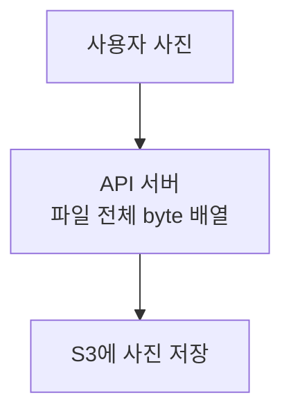
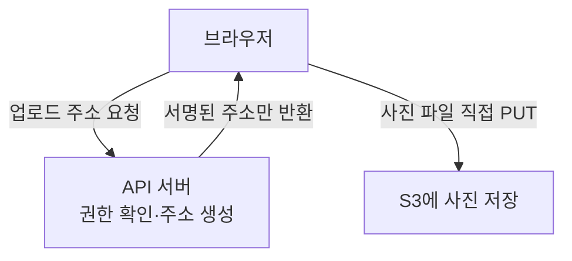
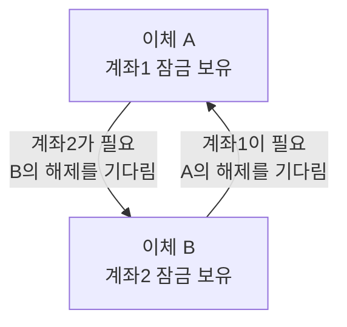

# Study 첫 5편 수정 초안 — 승인 전

2026-10-08. 공개 파일은 아직 수정하지 않았다.
아래는 변경할 본문과 보존할 심화 내용의 범위다. 파일 전체를 무조건 이 문서로 덮어쓰지 않는다.
기존 URL과 작성일은 유지하고 적용일에 updatedAt을 갱신한다. 새 Study와 로드맵 코드 변경은 없다.
조사 근거: [10/8 검증 기록](../../study-audit/2026-10-08-evidence-and-learning-plan.md).

## 승인할 파일과 핵심 정정

| 기존 파일 | 제안 제목 / 질문 | 원래 작성일 | 핵심 변경 |
| --- | --- | --- | --- |
| [JPA](../../../content/study/jpa/persistence-context-and-fetch-strategy.mdx) | 같은 상품을 두 번 찾으면, DB도 두 번 갈까? | 2026-07-21 | 같은 컨텍스트의 find 재사용과 연관 데이터 로딩을 구분. EAGER=SQL1회 정정 |
| [OSIV](../../../content/study/spring/open-in-view-connection-hold.mdx) | DB 작업은 끝났는데, 왜 연결이 부족할까? | 2026-10-02 | 요청·트랜잭션·세션·연결 수명을 분리. OSIV를 원인으로 단정하지 않음 |
| [S3](../../../content/study/aws/s3-presigned-url.mdx) | 큰 파일을 서버에 쌓지 않고 올리려면? | 2026-07-13 | 파일 이동 경로를 중심으로. 일회용·EC2 Role 자동 확정·메모리 실측 단정 정정 |
| [워터마크](../../../content/study/database/watermark-incremental-sync.mdx) | 변경분만 읽었는데, 왜 상품 하나가 빠질까? | 2026-07-29 | 쓰기 시각과 커밋 가시성 장면. xmin 커밋 순서·무손실·최대20초 보장 정정 |
| [데드락](../../../content/study/database/deadlock-lock-ordering.mdx) | 두 이체가 서로의 계좌를 기다리면? | 2026-10-07 | 순환 대기 그림, DB가 끊는 장면, 순서 통일과 재현 시험 분리 |

Learning Path, 다른 공개 글, 스킬은 이 묶음에서 수정하지 않는다.
관련/선수 메타데이터는 아래에 적은 실제 존재하는 Study로만 연결한다.
제목은 바꿔도 경로와 slug는 유지한다.

## 1. JPA — 본문 초안

질문: 같은 상품 ID를 두 번 찾으면 DB도 두 번 갈까?
한 줄 답: 같은 영속성 컨텍스트에 상품이 이미 있으면 find는 그 객체를 다시 쓸 수 있다.
조건: 같은 컨텍스트, 같은 엔티티 ID, 중간에 clear/분리하지 않은 일반적인 find 조회 예제다.
선수: jpa/orm-basics. 다음: jpa/n-plus-one-problem.

### 상품 7번을 찾는다

상품 상세를 만들다가 상품7이 두 번 필요해졌다. JPA가 관리하는 객체 보관 공간을
**영속성 컨텍스트**라고 한다. 이번 예제는 처음에 이 공간이 비어 있다고 가정한다.

```text
첫 find(7)
보관 공간 [비어 있음] → DB에서 상품7 읽음 → [상품7 객체 P]

두 번째 find(7)
보관 공간 [상품7 객체 P] → 같은 P 반환
                         DB 재조회 없음
```

결과: 같은 상품7 객체를 재사용한다. 이 공간 안의 재사용 기능을 **1차 캐시**라고 부른다.
모든 SQL 검색이 없어지는 캐시가 아니다. 조건을 검색하는 JPQL은 SQL을 실행할 수 있다.

### 상품은 있는데 판매자 정보도 있을까?

상품 객체와 그 상품이 참조하는 판매자 정보는 별개의 로딩 대상이다.

```text
화면이 상품명만 필요함     [상품7 이름 있음] [판매자 정보 아직 없음]
판매자 이름도 필요해짐    [상품7 이름 있음] [판매자 정보 로딩 필요]
```

**LAZY**는 연관 데이터의 로딩을 미룰 수 있게 하는 전략이다.
**EAGER**는 연관 데이터를 즉시 로딩해야 하는 전략이다.
둘은 '언제 필요한가'의 계약이지 'SQL 몇 번인가'의 답은 아니다.

EAGER여도 별도 조회가 나갈 수 있다. 같은 요청에서 관련 데이터를 묶어 가져오려면
조회 쿼리의 fetch join이나 EntityGraph 등을 검토하고 실제 SQL을 확인한다.
[Hibernate fetching](https://docs.hibernate.org/orm/current/userguide/html_single/#fetching)

### 무엇으로 확인할까?

같은 컨텍스트에서 find(7)을 두 번 호출한 SQL 기록과, 상품 목록에서 판매자에 접근한
SQL 기록을 따로 본다. '1차 캐시가 있으니 목록도 SQL1회'라고 판단하지 않는다.

<details>
<summary>보관 공간은 언제 사라지고, 프로젝트에는 어떤 매핑이 있나?</summary>

트랜잭션 범위 컨텍스트는 트랜잭션 종료와 함께 정리될 수 있다. 하지만 OSIV처럼 요청까지
EntityManager를 유지하는 구성도 있어 둘의 종료가 항상 같지는 않다.

10/8에 확인한 로컬 PromptHub의 Review.product는 LAZY, User.roles는 EAGER다.
이는 매핑의 존재만 확인한 결과이며 실제 SQL 횟수나 팀의 선택 이유는 측정하지 않았다.
기존 매핑 코드 두 개는 이 토글에 유지하고 annotation의 출처를 Jakarta Persistence로 설명한다.

</details>

회상 질문: 같은 상품7을 다른 요청에서 다시 찾을 때도 이 공간을 공유할까?
답: 일반적인 요청별 컨텍스트는 서로 다르다. 위 예제를 서버 전체 공유 캐시로 해석하면 안 된다.

## 2. OSIV — 본문 초안

질문: DB 작업 뒤 외부 API를 기다릴 때, 왜 다른 요청이 DB 연결을 못 얻을까?
한 줄 답: 외부 대기 동안 DB 연결을 실제로 반납하지 않았다면 다른 요청이 그 연결을 쓸 수 없다.
조건: 연결 점유가 확인된 상황이다. OSIV가 켜졌다는 것만으로 이 상황을 확정하지 않는다.
선수: jpa/persistence-context-and-fetch-strategy, database/connection-pool-hikaricp,
jpa/transactional-and-propagation. 다음: cs/database-bottleneck-diagnosis.

### 연결 한 자리를 A가 빌렸다

설명을 위해 DB 연결이 하나뿐이라고 하자. 연결은 DB와 대화할 때 빌리는 통로다.
A가 상품을 읽은 뒤 외부 API 응답을 기다리는 동안 B도 상품을 읽으려 한다.

```text
반납한 경우
A: [DB 조회·반납] [외부 API 기다림........]
B:               [같은 연결 빌려 DB 조회]

계속 점유한 경우
A: [DB 조회]     [연결을 가진 채 외부 API 대기] [반납]
B:               [연결 자리 기다림..........] [DB 조회]
```

결과: DB 계산이 느리지 않아도, 연결을 못 빌려서 요청이 느려질 수 있다.
위 숫자와 시간은 원리를 보여주는 독립 예시다.

### OSIV는 연결이 아니라 작업 공간을 오래 열어 둔다

**OSIV(open-in-view)**는 요청을 처리하는 동안 JPA의 작업 공간인 EntityManager를
유지해, 서비스 트랜잭션이 끝난 뒤에도 화면에서 연관 데이터를 로딩할 수 있게 하는 방식이다.
[Spring OSIV API](https://docs.spring.io/spring-framework/docs/current/javadoc-api/org/springframework/orm/jpa/support/OpenEntityManagerInViewFilter.html)

```text
요청:          [조회 처리][외부 API 대기][응답]
EntityManager: [─────────열려 있을 수 있음─────────]
트랜잭션:      실제 메서드 경계와 전파 설정으로 확인
DB 연결:       실제 획득·반납 시각으로 확인
```

작업 공간이 열렸다고 DB 통로도 계속 점유한다고 단정할 수는 없다.
Hibernate 연결 처리 모드와 트랜잭션 경계가 영향을 준다.
[Hibernate connection handling](https://docs.hibernate.org/orm/current/userguide/html_single/#transactions-connection-handling)

### 무엇을 바꾸기 전에 무엇을 볼까?

1. 외부 호출 구간에 트랜잭션이 열려 있는지 확인한다.
2. 연결의 획득부터 반납까지가 그 대기 구간을 포함하는지 확인한다.
3. 풀 대기 요청 수와 연결 점유 시간을 함께 본다.

느린 외부 호출을 DB 트랜잭션 밖으로 분리할지, 화면에 필요한 값을 서비스에서 미리
가져오고 OSIV를 끌지 선택한다. OSIV를 꺼도 외부 호출까지 감싼 긴 트랜잭션은 남을 수 있다.

<details>
<summary>설정과 기존 코드 예제는 어떻게 읽나?</summary>

open-in-view는 Spring Boot의 설정이다. 설정을 끌 때는 컨트롤러나 응답 직렬화에서
뒤늦게 연관 데이터를 읽는 경로를 점검한다. 필요한 값을 트랜잭션 안에서 준비하지 않으면
LazyInitializationException이 발생할 수 있다.

기존 PrepService 예제는 독립 설명용이다. 그 코드만 보고 최종 트랜잭션 경계를 확정하지 않는다.
10/8 로컬 PromptHub의 여러 서비스 설정에는 false가 있다. 배포된 최종 설정과 과거 장애
원인을 확인한 결과는 아니므로 현재 OSIV 장애 사례로 쓰지 않는다.

</details>

회상 질문: OSIV=false인데 외부 API를 기다리는 메서드 전체에 트랜잭션이 걸려 있다면?
답: 연결 점유 위험은 여전히 확인해야 한다. 스위치 하나가 모든 긴 트랜잭션을 없애지는 않는다.

## 3. S3 — 본문 초안

질문: 큰 파일을 서버 메모리에 전부 올리지 않고 저장하려면?
한 줄 답: 서버는 제한된 업로드 주소만 만들고, 파일 자체는 브라우저에서 S3로 보낼 수 있다.
조건: 서버에서 파일 전체를 처리해야 하는 요구가 없는 직접 업로드 설계다.
선수: 없음. 다음: jvm/gc-roots-reachability-and-memory-reclaim (선택적 메모리 심화).

### 파일은 어디를 지나갈까?

S3는 파일을 객체로 보관하는 AWS 서비스다. 사진 하나를 업로드할 때 두 경로를 비교하자.



결과: 서버가 파일 전체를 배열로 보관하는 방식이면, 큰 파일과 동시 요청이 메모리를 압박할 수 있다.
실제 복사본 수와 메모리 사용량은 구현에 따라 다르다.



결과: 이 업로드 파일의 bytes가 API 서버를 지나지 않는다.
파일 버퍼링 부담을 제거한 것이지 서버의 모든 메모리 문제를 해결한 것은 아니다.

### 서명 링크는 일회용 티켓이 아니다

서버가 만드는 **presigned URL**은 '어느 객체에, 어느 동작을, 언제까지 허용할지'를
서명한 주소다. 다운로드는 GET, 업로드는 PUT 동작을 사용한다.

```text
같은 다운로드 주소 (권한·객체·자격이 계속 유효한 예)
발급 후 1분: 요청 가능
발급 후 2분: 같은 주소로 다시 요청 가능
설정된 만료 후: 새 요청 불가
```

링크를 가진 사람이 사용할 수 있으므로, 원래 구매자만 쓸 것이라고 가정하지 않는다.
URL 만료보다 서명에 사용한 임시 자격이 먼저 만료되면 더 일찍 사용할 수 없게 된다.
[AWS presigned URL](https://docs.aws.amazon.com/AmazonS3/latest/userguide/using-presigned-url.html)

### 저장됐다고 바로 내 상품의 파일일까?

브라우저가 업로드를 마치면 서버에 object key를 전달한다. **object key**는 S3 안에서
파일을 가리키는 이름이다. 서버는 허용한 key와 실제 업로드 상태를 확인한 뒤 상품과 연결한다.
다운로드할 때도 구매 권한을 먼저 확인하고 짧은 유효 기간의 주소를 제공한다.

<details>
<summary>서버가 직접 파일을 받아야 한다면? SDK와 IAM Role은?</summary>

파일 검사 등으로 서버를 거쳐야 한다면 전체 배열 대신 작은 버퍼로 전달하는 스트리밍을
검토한다. 이 경우에도 서버 연결과 네트워크는 사용한다.

S3Presigner는 AWS SDK for Java의 외부 라이브러리 클래스다. 별도 SDK 의존성이 필요하다.
이 클래스는 URL 서명을 만들지만 사용자 구매 권한과 업로드 완료 검증까지 해주지는 않는다.

로컬 S3Config는 자격 공급자를 명시하지 않았다. 기본 체인은 여러 출처 중 먼저 찾은 자격을
사용하므로 이 코드만으로 EC2 IAM Role을 쓴다고 확정할 수 없다.
[AWS 자격 체인](https://docs.aws.amazon.com/sdk-for-java/latest/developer-guide/credentials-chain.html)

기존 서버 스트리밍·heap 설명과 업로드 제한 목록은 이 심화 영역에 보존하되, 영상의
80.9MB/320.3MB 등 재검증하지 않은 숫자는 제거한다. Content-Type 서명은 실제 파일 내용의
안전성을 검사하는 기능과 구분한다.

</details>

회상 질문: 구매자가 만료 전 링크를 다른 사람에게 보내면 그 사람도 요청할 수 있을까?
답: URL과 권한·자격·정책이 유효하면 가능하다. 발급 권한 확인만으로 링크 공유까지 막지는 않는다.

## 4. 워터마크 — 본문 초안

질문: 바뀐 상품만 읽는 배치에서 상품 하나가 왜 빠질까?
한 줄 답: 수정 시각은 이전인데 커밋이 늦으면, 읽기 기준이 그 상품을 지나칠 수 있다.
조건: updated_at 시각으로 변경분을 찾는 예제다.
선수: jpa/transactional-and-propagation. 다음: msa/outbox-inbox-when-needed.

### 배치는 책갈피 뒤쪽만 읽는다

상품 원본을 검색 저장소로 복사할 때 매번 전부 읽는 대신 지난 성공 시점을 기억한다.
그 시점이 **워터마크**, 즉 다음에 어디서 읽을지 알려주는 책갈피다.

```text
지난 책갈피 10:00:00
다음 조회: updated_at이 10:00:00 이후인 상품
```

### 상품7은 바뀌었는데 아직 보이지 않는다

```text
10:00:00  A가 상품7 수정. updated_at=10:00:00
10:00:03  배치 조회. A는 미커밋이라 상품7 변경이 안 보임
          배치 성공 후 책갈피=10:00:03
10:00:05  A 커밋. 이제 상품7 변경이 보임
다음 조회 10:00:03 이후만 찾음 → 상품7은 범위 밖
```

결과: 배치는 그 순간 보이는 변경을 처리했어도, 늦게 커밋된 상품을 놓칠 수 있다.
이는 독립 설명 예제이며 실제 누락 발생 기록이 아니다.

### 책갈피를 조금 뒤로 물리면?

```text
책갈피 10:00:03
30초 뒤로 물린 조회 시작=09:59:33
다음 조회가 A 커밋 뒤 실행됨 → 상품7도 다시 찾을 수 있음
```

이미 옮긴 상품을 다시 처리할 수 있으므로 같은 반영을 반복해도 결과가 어긋나지 않아야 한다.
그 성질이 **멱등성**이다. 하지만 30초보다 오래 지연된 변경까지 자동으로 보호하지는 않는다.

### '호출 성공'과 '모든 상품 반영 성공'은 다르다

```text
상품7: 반영 성공
상품8: 반영 실패
응답: 항목별 결과 포함

실패를 확인하지 않고 책갈피 전진 → 상품8 재처리 기회가 빠질 수 있음
```

책갈피를 옮기기 전 처리 결과를 확인하고 실패 항목을 다시 찾을 방법을 둔다.
삭제·범위 밖 누락은 주기 전체 대조 같은 별도 안전망도 검토한다.

<details>
<summary>xmin, 20초 스케줄과 기존 심화 내용</summary>

xmin은 행 버전을 만든 트랜잭션 ID이지 커밋 순번이 아니다.
먼저 쓰기 시작한 A가 B보다 늦게 커밋할 수 있으므로 단순 xmin 책갈피로 바꾸면 해결된다고
쓰지 않는다. CDC의 변경 로그 전달과도 다른 개념이다.
[PostgreSQL 트랜잭션 ID](https://www.postgresql.org/docs/18/transaction-id.html)

10/8 로컬 스케줄러는 성공했을 때 실행 시작 시각을 저장하고 30초 오버랩을 사용한다.
기본 20초 fixedDelay는 실행 종료 후 다음 실행까지 대기한다는 뜻이지 최대 반영 지연 보장이 아니다.
운영 무손실이나 실제 배포 상태를 검증한 결과는 아니다.

기존 해시 비교·감사 시각 우회·429·삭제 감지 설명은 선택적 심화로 유지한다.
Outbox 비교표의 '유실 없음·순서 보장'은 조건부 발행 보호로 정정한다.
미조치 프로젝트 위험의 상세 경로나 재현 절차는 공개 본문에 추가하지 않는다.

</details>

회상 질문: 오버랩이30초인데 트랜잭션이2분 뒤에 커밋되면?
답: 오버랩만으로는 충분하지 않을 수 있다. 지연 조건과 별도 누락 복구를 확인해야 한다.

## 5. 데드락 — 수정할 장면과 시험 설명

질문/선수/한 줄 답은 기존 범위를 유지한다. 다음은 database/isolation-levels-and-locking의
심화 비교로 연결하며 필수 학습 순환은 만들지 않는다.

### 각자 계좌 하나를 가진 채 기다린다

계좌1→2 이체A와 계좌2→1 이체B가 동시에 왔다. 행 잠금은 같은 계좌가 중간에 다른
트랜잭션으로 바뀌지 않도록 하는 장치다.



결과: 서로가 가진 잠금을 기다려 둘 중 누구도 진행할 수 없다. 이 순환이 데드락이다.
PostgreSQL은 이를 감지하면 한 트랜잭션을 중단해 고리를 끊는다.
'영원히 기다림'은 DB의 감지·중단이 없을 때의 원리를 뜻한다고 명시한다.

### 방향은 달라도 잠금 순서는 같게

```text
A (1→2): 계좌1 잠금 → 계좌2 잠금 → 이체·commit
B (2→1): 계좌1을 기다림 (계좌2를 먼저 잡지 않음)
         A가 놓으면 계좌1 → 계좌2 잠금 → 이체·commit
```

결과: 이 두 계좌 잠금만 있는 예에서는 B가 상대 잠금을 보유한 채 A를 기다리는 고리가 없다.
다른 경로에서도 같은 순서가 적용돼야 하며, 더 많은 자원의 데드락까지 모두 없애는 규칙은 아니다.
[PostgreSQL deadlocks](https://www.postgresql.org/docs/18/explicit-locking.html#LOCKING-DEADLOCKS)

기존 Math.min/Math.max와 이체 방향을 분리하는 코드는 설명 토글로 옮긴다.
DB 오류 검사 시점은 deadlock_timeout 설정에 영향을 받으므로 항상 정확히1초 성공/실패라고 쓰지 않는다.

### 시험도 두 종류로 나눈다

교착 재현에서는 A가 계좌1, B가 계좌2를 잡은 뒤 두 번째 잠금으로 진행시킨다.
순서 통일 시험에서는 첫 잠금 전에 함께 출발시키고 두 이체가 제한 시간 안에 완료되는지 확인한다.

순서를 맞춘 뒤에도 '둘 다 첫 잠금을 얻고 만나자'고 하면 B는 계좌1을 못 얻어서
시험 자체가 멈출 수 있다. 정상 시험에는 그 조건을 쓰지 않는다.
두 계좌 잔액의 합도 확인하되 이 시험을 아직 실행한 결과처럼 쓰지 않는다.

기존 남은 위험과 프로젝트 근거 토글, 세 이체 회상 질문은 보존한다.

## 적용 전 편집 체크

- 위 본문은 글마다 하나의 질문을 중심에 두고, 나머지는 기존 토글 또는 관련 글로 보존한다.
- 단순 흐름 상자를 늘리지 않고 같은 상품7, 연결A/B, 업로드 사진, 계좌1/2를 끝까지 유지한다.
- 사진 경로와 잠금 고리는 Mermaid, 늦은 커밋과 연결 대기는 타임라인으로 표현한다.
- 모바일에서 장면과 '결과'를 함께 읽을 수 있는지 적용 뒤 검증한다. 이 초안은 화면 검증 전이다.
- 날짜/URL 유지와 five-file 범위 확인 뒤 공개 MDX 작성, 관련 diff/인용 자료 민감정보 자동 검사,
  링크/스키마/테스트/타입/build 검증을 수행한다. 실행 중 dev와 build 출력은 겹치지 않게 한다.
- 영상의 수치를 제거하는 것은 출처가 틀렸다는 판정이 아니라 재현 근거 없는 수치를
  내 글의 결과로 사용하지 않겠다는 편집 선택이다.
- 새 컴포넌트, 별도 구현 프로젝트, 공개 로드맵 재배치와 외부 배포는 승인 범위가 아니다.
